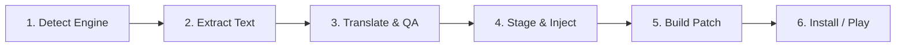

<div align="center">
  
# 🇮🇷 FarsiForge (فارسی‌فورج)

**A professional, evidence-driven game localization workbench with format-specific extraction, Persian RTL shaping, and reversible patch installers.**

[](https://golang.org)
[](https://reactjs.org/)
[](https://nextjs.org/)
[](https://wails.io)
[](https://t.me/farsiforge)
[](LICENSE)

*FarsiForge automates the complex pipeline of game localization for the Persian (Farsi) language. It provides game engine detection, native archive unpacking, high-fidelity string extraction, bidirectional text reshaping, safe format injection, and standalone reversible patch generation.*

</div>

---

## ✨ Features

- **🚀 Heuristic Engine Detection:** Automatically scans and detects 13 distinct engine families (Unreal Engine 3/4/5, Godot 3/4, Unity Mono/IL2CPP, FromSoftware, RAGE, Source/Source2, SAGE, Factorio, Project Zomboid, GoldSrc, and Generic Custom Engines) with confidence scoring and capability badges.
- **📝 High-Fidelity Format Extraction:**
  - **FromSoftware:** Native BHD5/BDT archive extraction, DCX compression handling, BND3/BND4 containers, and FMG string table parsing (v1/v2 wide/Unicode).
  - **RAGE (Rockstar Games / GTA V):** Traversal and decryption of encrypted RPF7 archives using AES-256-ECB and Knuth 32-bit PRNG table derivation via `magic.dat`, plus GXT2 text parsing.
  - **Unreal Engine:** Deep parsing of `.locres` (versions 0, 1, 2, and 3), `.pak` archive extraction via `repak`, and UE5 IoStore container extraction (`.utoc` / `.ucas`) via `retoc`.
  - **Godot Engine:** Recovers text from PCK v2, v3, and v4 (supporting Godot 4.7/4.8) via `gdre_tools v2.8.0`, plus binary `OptimizedTranslation` resource import/export and standalone unencrypted PCK rebuild.
  - **Unity:** TextAsset and MonoBehaviour text extraction across Mono and IL2CPP builds with typetree validation.
  - **Other Engines:** Valve KeyValues (Source 2 / Deadlock, GoldSrc), SAGE (`.big`, `.csf`), Factorio (`locale/*.cfg`), Project Zomboid (Lua translation tables), and structured generic files (`.json`, `.xml`, `.csv`, `.ini`, `.txt`, `.yaml`).
- **💉 Safe Staged Translation Injection:**
  - Dedicated roundtrip write-back pipelines that strictly stage modified assets in an isolated workspace.
  - Original game installations are strictly treated as **read-only** and never mutated during extraction or staging.
  - SHA-256 integrity binding guarantees that patch packages are only built against verified, uncorrupted base assets.
- **🔄 Persian Text Shaping & Typography:**
  - Integrated bidirectional (BiDi) reordering and Right-to-Left (RTL) reshaping.
  - Zero-Width Non-Joiner (ZWNJ / نیم‌فاصله) preservation and automatic Arabic-Indic / Persian digit normalization.
  - Tag, placeholder, and markup protection preventing UI variable corruption during translation.
- **📦 Standalone Reversible Patch Installer (FFP1):**
  - High-performance, zero-dependency C# GUI patcher (`FarsiForgePatcher.exe`) and CLI (`FarsiForgePatcherCli.exe`).
  - Preflight reparse-point and directory symlink security checks preventing path escape attacks.
  - Automatic backup of original game files and atomic byte-for-byte uninstall/restore capability.
- **🎨 Interactive Desktop Workbench & Headless CLI:**
  - Modern desktop interface built on Wails v2, Next.js 14, and TailwindCSS with fuzzy search, status filters (Untranslated, In Progress, QA, Approved), and QA notes.
  - Fully featured headless CLI (`farsiforge-cli.exe`) for automation, CI/CD, and batch scripts.

---

## 🎮 Engine Capability & Support Matrix

In professional game localization, **Detection**, **Extraction**, **Injection (Write-Back)**, and **Patching** are distinct engineering stages. FarsiForge explicitly documents capability boundaries:

| Engine / Family | Detection | Extraction | Injection / Staging | Patching (FFP1) | Verification & Evidence |
|-----------------|:---------:|:----------:|:-------------------:|:---------------:|-------------------------|
| **FromSoftware** (Elden Ring / Souls) | ✅ | ✅ BHD5/BDT, DCX, BND3/BND4, FMG (v1/v2) | ✅ Pure Go FMG encoder, DCX DFLT compressor, BND4 writer | ✅ | Verified on *ELDEN RING* Data0 (520,750 entries across 24 message bundles; extraction & roundtrip write-back verified). |
| **Unreal Engine 4 / 5** | ✅ | ✅ `.locres` (v0–v3), `.pak` (repak), IoStore `.utoc`/`.ucas` (retoc) | ⚠️ Loose `.locres` staging & write-back via `fftools` (compiled `.uexp` marked read-only) | ✅ | Verified on *Hacker Simulator* (11,676 entries) and *Fortnite* (85 `.pak` containers). |
| **Godot 3 / 4** | ✅ | ✅ Recovered `.tres/.gd/.tscn` text (gdre_tools v2.8.0), PCK v2–v4, `.translation` export | ⚠️ Updates CSV-resolved `.translation` resources in unencrypted PCK v2–v4 via `fftools` | ✅ | Verified on *MOLDRISE v1.0.5* (Godot 4.7, PCK v4, 3,789 strings) and synthetic PCK roundtrip tests. |
| **Unity** (Mono + IL2CPP) | ✅ | ✅ UnityPy TextAsset & recovered MonoBehaviour paths | ⚠️ Requires verified writable typetree identity; raw-byte candidates rejected | ✅ | Verified on *ASKA* (324,899 entries), *Raft* (59,111 entries), and *Orc Massage* (13,148 entries). |
| **Generic / Custom** | ✅ | ✅ Structured text (`.json`, `.txt`, `.ini`, `.csv`, `.tsv`, `.xml`, `.yaml`) | ✅ Direct in-place staging for structured text | ✅ | Verified on *DDPER 8.4* and synthetic fixture matrices. |
| **RAGE** (GTA V) | ✅ | ✅ Encrypted RPF7 traversal (AES-256-ECB + Knuth PRNG tables via `magic.dat`), Deflate, GXT2 | ❌ Extract-only (re-encrypting RPF7 archives is not supported; loose-file modding recommended) | ❌ | Verified on *Grand Theft Auto V* build 1.0.3725.0 (8,669,936 strings across 43 archives). |
| **SAGE** (C&C Generals / ZH / RA3) | ✅ | ✅ `.big`, `.csf`, and `.str` archive & string table reader | ❌ Extract-only (write-back not implemented) | ❌ | Verified on *C&C Zero Hour* (1,532 strings) and *Red Alert 3* (10,956 strings). |
| **Source 2** (Deadlock / CS2) | ✅ | ✅ Valve KeyValues localization files | ❌ Extract-only | ❌ | Verified on *Deadlock* (53,522 entries). |
| **Factorio** | ✅ | ✅ `locale/*.cfg` localization files | ❌ Extract-only | ❌ | Verified on *Factorio* (7,019 entries). |
| **Project Zomboid** | ✅ | ✅ Lua translation table files | ❌ Extract-only | ❌ | Verified on *Project Zomboid* (14,058 entries). |
| **GoldSrc** (Half-Life / CS 1.6) | ✅ | ✅ Valve KeyValues localization files | ❌ Extract-only | ❌ | Verified format extraction path. |
| **Unreal Engine 3** | ✅ | ❌ Generic text fallback only | ❌ Detection-only | ❌ | Heuristic detection only. |
| **Source 1** (HL2 / Portal) | ✅ | ❌ Generic text fallback only | ❌ Detection-only | ❌ | Heuristic detection only. |

> [!NOTE]
> Engines marked as **Extract-only** or **Detection-only** are clearly labeled in the user interface with status badges and disabled buttons to prevent partial or unsafe writes.

---

## 📊 Real-Game Validation Matrix

The following real-world game installations have been analyzed and verified:

| Game | Engine / Family | Extracted Entries / Scope | Pipeline Status |
|------|-----------------|---------------------------|-----------------|
| **Grand Theft Auto V** | RAGE | 8,669,936 strings across 43 `.rpf` archives | ✅ Extraction (Decrypted RPF7 + GXT2) |
| **ELDEN RING** | FromSoftware | 520,750 entries across 24 message bundles | ✅ Extract + Write-Back (FMG / DCX / BND4) |
| **ASKA** | Unity IL2CPP | 324,899 entries | ✅ Extraction |
| **Deadlock** | Source 2 | 53,522 entries | ✅ Extraction |
| **Raft** | Unity Mono | 59,111 entries | ✅ Extraction |
| **Project Zomboid** | Java / Lua | 14,058 entries | ✅ Extraction |
| **Orc Massage** | Unity Mono | 13,148 entries | ✅ Extraction |
| **Hacker Simulator** | Unreal Engine | 11,676 entries | ✅ Extraction + Staging |
| **Red Alert 3** | SAGE | 10,956 entries | ✅ Extraction |
| **Factorio** | Custom | 7,019 entries | ✅ Extraction |
| **MOLDRISE v1.0.5** | Godot 4.7 | 3,789 strings across 467 files | ✅ Extraction (PCK v4 + GDRE tools) |
| **C&C Zero Hour** | SAGE | 1,532 entries | ✅ Extraction |
| **Fortnite** | Unreal Engine 5 | 85 `.pak` containers | ✅ Detection + Container Indexing |

---

## 🏗️ Architecture

```
FarsiForge Workspace
├── cmd/
│   └── farsiforge-cli/     # Headless CLI binary
├── frontend/               # Next.js 14 + TailwindCSS + Radix UI workbench interface
├── patcher/                # Standalone C# .NET GUI & CLI patch installer (FFP1 format)
│   ├── FarsiForgePatcher.cs# Single-file C# source (compiled with csc.exe)
│   ├── build.ps1           # Zero-dependency build script producing GUI and CLI exes
│   └── FORMAT.md           # FFP1 binary package specification (v1 & v2)
├── pkg/
│   ├── core/               # Domain models, project persistence, translation entries
│   ├── detection/          # Priority-ranked heuristic game engine detectors
│   ├── extract/            # Native format extractors (BND4, DCX, FMG, GXT2, RPF7, locres, etc.)
│   ├── inject/             # Safe format encoders & staging injectors
│   ├── ffpatch/            # FFP1 binary package builder & unpacker
│   ├── installer/          # Go-side patch installer orchestration
│   ├── persian/            # RTL text reshaping, Bidi reordering, and ZWNJ handling
│   ├── tools/              # Helper tool discovery and execution registry
│   └── validate/           # Pre-injection validation and tag/placeholder checks
└── Tools/                  # Discovered helper binaries (managed per engine)
```

---

## 🛠️ Integrated Helper Tools & Organization Ecosystem

FarsiForge orchestrates specialized companion utilities curated within the [FarsiForge-dev](https://github.com/FarsiForge-dev) organization:

| Tool | Source / Fork | Description & Responsibility |
|------|---------------|------------------------------|
| **`fftools.exe`** | [FarsiForgeTools](https://github.com/FarsiForge-dev/FarsiForgeTools) | Native companion CLI for Unreal `.locres` (v0–v3) encoding/decoding, Godot `.translation` (`OptimizedTranslation`) CSV import/export, and PCK rebuilding. |
| **`FarsiForgePatcher.exe`** | [FarsiForge/patcher](file:///d:/FarsiForge-dev/FarsiForge/patcher) | High-performance C# Windows Forms installer with backup, atomic rollback, and uninstall. |
| **`repak.exe`** | [FarsiForge-dev/repak](https://github.com/FarsiForge-dev/repak) | Blazing-fast Unreal Engine `.pak` archive extractor. |
| **`retoc.exe`** | [FarsiForge-dev/retoc](https://github.com/FarsiForge-dev/retoc) | Unreal Engine 5 IoStore container (`.utoc` / `.ucas`) unpacker. |
| **`gdre_tools.exe`** | [FarsiForge-dev/gdsdecomp](https://github.com/FarsiForge-dev/gdsdecomp) | Godot PCK reverse-engineering and asset recovery toolkit (v2.8.0 with headless native console subsystem). |
| **`magic.dat`** | [FarsiForge-dev/CodeWalker](https://github.com/FarsiForge-dev/CodeWalker) | Modern lookup tables for Rockstar RAGE RPF7 AES key derivation. |
| **`UnityPy`** | [FarsiForge-dev/UnityPy](https://github.com/FarsiForge-dev/UnityPy) | Python module for Unity typetree asset extraction and serialization. |
| **`vazirmatn`** | [FarsiForge-dev/vazirmatn](https://github.com/FarsiForge-dev/vazirmatn) | High-legibility Persian typeface bundled for game UI injection. |

---

## 🚀 Getting Started

### Prerequisites

- [Go 1.22+](https://golang.org/dl/)
- [Node.js 20+](https://nodejs.org/)
- [Wails CLI v2](https://wails.io/docs/gettingstarted/installation) (`go install github.com/wailsapp/wails/v2/cmd/wails@latest`)
- Windows PowerShell / PowerShell 7+ (for building the C# patcher)
- Python 3.10+ with `pip` (optional, for Unity asset extraction)

### Installation & Build

1. **Clone the repository:**
   ```bash
   git clone https://github.com/FarsiForge-dev/FarsiForge.git
   cd FarsiForge
   ```

2. **Build the Desktop Application (Wails):**
   ```bash
   wails build -platform windows/amd64 -s
   ```
   *The executable will be generated at `build/bin/FarsiForge.exe`.*

3. **Build the CLI tool:**
   ```bash
   go build -o build/bin/farsiforge-cli.exe ./cmd/farsiforge-cli
   ```

4. **Build the C# Patcher:**
   ```powershell
   pwsh -File patcher/build.ps1
   ```

5. **Run the Automated Test Suite:**
   ```bash
   go test ./... -count=1
   ```

---

## 💡 Recommended Workflow



1. **Detect**: Select the game root directory. FarsiForge detects the game engine, displays detection confidence, and indicates available capabilities (Full Pipeline vs. Extract-Only).
2. **Extract**: Unpack archives and extract strings into an isolated project file (`.ffproj`).
3. **Translate**: Edit strings using the responsive grid with search, status filters (Untranslated, In Progress, QA, Approved), and QA notes.
4. **Stage Changes**: Run injection to shape Persian text (RTL, ZWNJ, digit normalization) and stage format-compliant modified files inside the project workspace (the installed game remains untouched).
5. **Build & Apply Patch**: Package staged files into an FFP1 translation installer. The end-user patcher validates the game installation, backs up original files, and applies the translated assets with 1-click uninstall.

---

## 🤝 Contributing

Contributions, bug reports, and format additions are warmly welcomed! Please check open issues or submit pull requests.

## 📄 License

This project is licensed under the [MIT License](LICENSE).

<div align="center">
  <i>Developed with ❤️ for the Persian Gaming Community</i>
</div>
